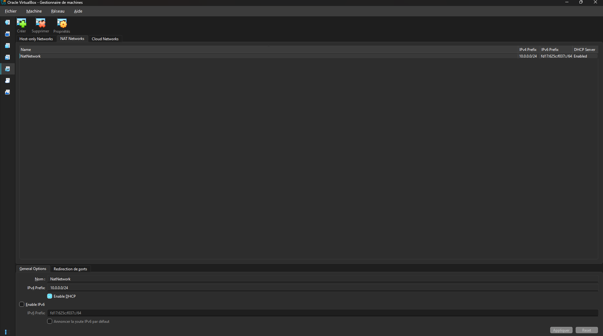

# week1-project-cybersecurity-with-networkwalks-B084-lab-setup
# 🔐 First Cybersecurity Lab Setup

**Building an isolated virtual laboratory for penetration testing and ethical hacking practice.**


---

## 📌 Project Overview

This project focuses on building and configuring a virtual cybersecurity laboratory using **Oracle VirtualBox** and **Kali Linux**.

The main goal is to create an isolated and controlled environment where cybersecurity tools and techniques can be explored and tested safely.

The laboratory is designed to support practical activities such as network reconnaissance, port scanning, vulnerability assessment, packet analysis, and penetration-testing exercises.

By configuring a private virtual network, additional virtual machines can be connected in the future to simulate real-world network environments and perform authorized security testing.

## 🎯 Project Objectives

The main objectives of this project are to:

- Install and configure Oracle VirtualBox.
- Import and configure Kali Linux as a virtual machine.
- Create a private NAT Network for the laboratory.
- Configure network connectivity for Kali Linux.
- Assign a consistent IPv4 address to the Kali virtual machine.
- Verify network connectivity and DNS resolution.
- Create a clean virtual machine snapshot for recovery.
- Document the complete installation and configuration process.
- Prepare the laboratory for future cybersecurity projects.

## 🛡️ Purpose of the Laboratory

This laboratory provides a controlled environment for cybersecurity learning, experimentation, and authorized security testing.

It can be used for future practical exercises involving:

- Network reconnaissance.
- Port scanning and service enumeration.
- Vulnerability assessment.
- Packet capture and network analysis.
- Web application security testing.
- Exploitation practice.
- Cybersecurity tool experimentation.

## 🏗️ Lab Architecture

The laboratory uses a private NAT Network to connect Kali Linux to the virtual networking environment.

*Note: The target machine is planned for future laboratory exercises and is not necessarily part of the initial setup.*

The NAT Network allows multiple connected virtual machines to communicate with each other while providing outbound network connectivity through network address translation.

## ⚙️ Lab Configuration

The following table summarizes the hardware and network configuration used for this project.

### System Configuration

| Component | Configuration |
|---|---|
| Host Operating System | Windows 11 |
| Host RAM | 8 GB |
| Processor | Intel Core i7 |
| Hypervisor | Oracle VirtualBox 7.2 |
| Security Operating System | Kali Linux 2026.2 |
| Kali Linux RAM | 2048 MB |
| Virtual Network Type | NAT Network |
| Network Name | NatNetwork |

### Network Configuration

| Parameter | Value |
|---|---|
| Network Address | `10.0.0.0/24` |
| Kali Linux IP Address | `10.0.0.2/24` |
| Subnet Mask | `255.255.255.0` |
| Default Gateway | `10.0.0.1` |
| DNS Server | `8.8.8.8` |
| Future VM Address Range | `10.0.0.3 – 10.0.0.99` |

*The gateway and DNS values should be verified against the actual VirtualBox NAT Network configuration.*

## 🪜 Lab Setup Procedure

### Step 1: Install 7-Zip

7-Zip was installed to extract the Kali Linux virtual machine package, which may be distributed in `.7z` archive format.

**Tool:** [7-Zip](https://7-zip.org/download.html)

### Step 2: Install VirtualBox

Oracle VirtualBox was installed to provide the virtualization environment required to run Kali Linux.

**Tool:** [Oracle VirtualBox](https://virtualbox.org/wiki/Downloads)

### Step 3: Create the NAT Network

A dedicated NAT Network was created in VirtualBox to provide communication between virtual machines and outbound network connectivity.

**Network configuration:**

| Setting | Value |
|---|---|
| Network Name | `NatNetwork` |
| IPv4 Prefix | `10.0.0.0/24` |
| DHCP | Enabled |
| IPv6 | Disabled |

A NAT Network was selected instead of a standard NAT configuration because multiple virtual machines connected to the same NAT Network can communicate with each other.

This configuration will allow additional attacker and target machines to be introduced into the laboratory in future projects.

### Step 4: Import and Configure Kali Linux

Kali Linux was downloaded from its official website and imported into VirtualBox.

**Official download:** [Kali Linux](https://www.kali.org/get-kali/)

The virtual machine network adapter was configured as follows:

| Setting | Configuration |
|---|---|
| Adapter | Adapter 1 |
| Attached To | NAT Network |
| Network | `NatNetwork` |
| Adapter Type | Intel PRO/1000 MT Desktop |

**Virtual machine resources:**

- Allocated RAM: 2048 MB.
- Operating System: Kali Linux.
- Network Connection: NAT Network.

A shared folder was also configured to facilitate file transfers between the Windows host machine and the Kali Linux virtual machine.

### Step 5: Configure Kali Linux Network Settings

After importing Kali Linux, the network configuration was checked and adjusted to ensure consistent network addressing.

The following IPv4 configuration was used:

| Parameter | Value |
|---|---|
| IP Address | `10.0.0.2` |
| Subnet Mask | `255.255.255.0` |
| Default Gateway | `10.0.0.1` |
| DNS Server | `8.8.8.8` |

A consistent IP address makes it easier to identify the Kali machine and reference it during future laboratory exercises.

**Important:** Since DHCP is enabled on the NAT Network, the static IP address should be outside the DHCP allocation range or excluded from it to prevent IP address conflicts.

### Step 6: Create a Clean Virtual Machine Snapshot

After completing the initial installation and network configuration, a VirtualBox snapshot was created.

 

This snapshot represents the initial working state of the laboratory.

It provides a recovery point that can be restored if future experiments modify the system, damage configurations, or introduce unwanted changes.

Creating a clean snapshot before performing security experiments is an important virtualization best practice.

## 🔎 Lab Verification and Testing

After configuring the environment, several tests were performed to verify that the laboratory was functioning correctly.

| Test | Command | Expected Result |
|---|---|---|
| Check IP Address | `ip a` | Correct Kali IP address displayed |
| Check Default Gateway | `ping 10.0.0.1` | Successful replies |
| Test Internet Connectivity | `ping 8.8.8.8` | Successful replies |
| Test DNS Resolution | `nslookup networkwalks.com` | Domain name resolves to an IP address |
| Verify Nmap Installation | `nmap --version` | Nmap version displayed |
| Verify Snapshot | Restore snapshot and run `ip a` | Baseline configuration restored |

### Example Network Configuration

```text
IP Address:       10.0.0.2/24
Default Gateway:  10.0.0.1
DNS Server:       8.8.8.8
```

These checks help confirm that the virtual machine has the expected network configuration and that the required services are accessible.

*Note: ICMP traffic may occasionally be filtered. Therefore, an unsuccessful ping does not always indicate that internet connectivity is unavailable.*

## 🐞 Problems Encountered and Solutions

During the setup process, some configuration and virtualization issues were encountered.

Documenting these problems and their solutions is an important part of technical troubleshooting.

### Problem 1: Internet Connectivity After Static IP Configuration

After manually configuring the IPv4 settings, internet connectivity may fail depending on the Kali Linux and NetworkManager configuration.

One workaround used during this laboratory setup was:

```bash
sudo nmcli connection modify "Wired connection 1" ipv4.dad-timeout 0
```

The network connection was then restarted, and connectivity was tested again.

**Important considerations:**

- Network connection names may differ between systems.
- Identify the actual connection name before executing the command.
- The `ipv4.dad-timeout` setting relates to IPv4 duplicate address detection; it should not be treated as a universal solution for connectivity problems.
- Verify the IP address, gateway, DNS configuration, and DHCP allocation range when troubleshooting network connectivity.

To list available NetworkManager connections:

```bash
nmcli connection show
```

### Problem 2: VirtualBox VT-x / Hardware Virtualization Error

Initially, the virtual machine failed to start because hardware virtualization was disabled in the computer's BIOS/UEFI firmware.

**Solution:**

1. Restart the computer.
2. Enter the BIOS/UEFI configuration menu.
3. Locate the virtualization settings.
4. Enable Intel VT-x or the corresponding hardware virtualization option.
5. Save the changes and restart the computer.
6. Launch the Kali Linux virtual machine again.

After enabling hardware virtualization, the virtual machine started successfully.

## 💡 What I Learned

This project provided an opportunity to develop practical knowledge of virtualization, networking, and cybersecurity laboratory configuration.

The most important concepts and skills developed include:

### 1. NAT vs. NAT Network

I learned the difference between standard NAT and NAT Network configurations in VirtualBox.

- **NAT:** Allows a virtual machine to access external networks through the host's network connection. By default, machines using separate standard NAT adapters are not directly connected to a shared private network.
- **NAT Network:** Allows multiple virtual machines connected to the same NAT Network to communicate with each other while also providing outbound network connectivity.

Understanding this difference is important when designing a multi-machine cybersecurity laboratory.

### 2. Virtual Machine Networking

I gained a better understanding of how virtual network adapters connect virtual machines to different network configurations.

I also learned how network adapter settings influence communication between virtual machines and external networks.

### 3. Static IP Configuration

I practiced configuring and verifying IPv4 network parameters, including:

- IP addressing.
- Subnet masks.
- Default gateways.
- DNS servers.

I also understood why consistent IP addressing is useful when managing multiple virtual machines.

### 4. Virtual Machine Snapshots

I learned how to create and restore snapshots in VirtualBox.

A clean snapshot provides a known-good recovery point before conducting experiments that could modify or affect the virtual machine.

### 5. Network Connectivity and DNS Testing

I practiced using Linux networking commands to verify network configuration, test connectivity, and troubleshoot DNS resolution.

### 6. Technical Documentation

Finally, I learned the importance of documenting technical procedures, configuration settings, commands, encountered problems, and their solutions.

Clear documentation makes technical work easier to understand, reproduce, maintain, and share.

## 🔐 Security and Ethical Considerations

This laboratory is intended exclusively for educational purposes and authorized security testing.

All future penetration-testing activities must be conducted against systems that I own or have explicit permission to test.

The private virtual network provides a controlled environment for learning and experimentation, but its configuration should still be reviewed before connecting additional machines or performing security exercises.

## 🔗 Tools and Resources

The following official resources were used during the project:

| Tool / Resource | Description | Official Link |
|---|---|---|
| 7-Zip | Archive extraction utility | [Download](https://7-zip.org/download.html) |
| Oracle VirtualBox | Virtualization software | [Download](https://virtualbox.org/wiki/Downloads) |
| Kali Linux | Penetration-testing operating system | [Download](https://www.kali.org/get-kali/) |

## 👤 Author

**Project completed as part of the Cybersecurity Internship Program at NetworkWalks — Batch B084.**

This repository documents the practical work completed during the first project of the program.

## 📌 Project Information

| Category | Details |
|---|---|
| Program | Cybersecurity Internship at NetworkWalks |
| Batch | B084 |
| Week | 01 |
| Project | Cybersecurity & Penetration Testing Lab Setup |
| Main Tools | VirtualBox, Kali Linux, 7-Zip |
| Repository | GitHub |

---

**One project completed, many more challenges ahead!** 🔐🚀

